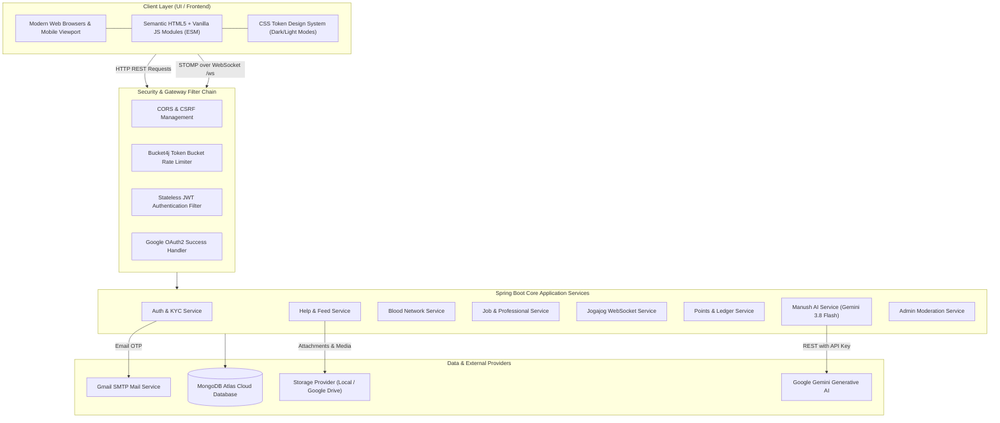

# 🇧🇩 Manush (মানুষ) — People Helping People

> **A Hyperlocal Community Assistance, Mutual Aid, Blood Network & Micro-Opportunity Platform for Bangladesh.**

[](https://spring.io/projects/spring-boot)
[](https://openjdk.org/)
[](https://www.mongodb.com/)
[](https://ai.google.dev/)
[](https://www.docker.com/)
[](LICENSE)

---

## 📌 Table of Contents
- [Project Vision](#-project-vision)
- [System Architecture](#-system-architecture)
- [Deep Dive into Core Domains](#-deep-dive-into-core-domains)
  - [1. Authentication, Security & KYC](#1-authentication-security--kyc)
  - [2. Hyperlocal Community Feed](#2-hyperlocal-community-feed)
  - [3. Mutual Aid & Help Requests](#3-mutual-aid--help-requests)
  - [4. Emergency Blood Bank Network](#4-emergency-blood-bank-network)
  - [5. Manush AI Assistant (Google Gemini 3.8 Flash)](#5-manush-ai-assistant-google-gemini-38-flash)
  - [6. Jogajog (যোগাযোগ) — Real-Time Chat](#6-jogajog-যোগাযোগ--real-time-chat)
  - [7. Micro-Jobs & Local Services](#7-micro-jobs--local-services)
  - [8. Gamified Helping Points & Badges](#8-gamified-helping-points--badges)
  - [9. Administrative Moderation & Auditing](#9-administrative-moderation--auditing)
- [Database Data Models](#-database-data-models)
- [REST API Specifications](#-rest-api-specifications)
- [Environment Configuration](#-environment-configuration)
- [Getting Started Locally](#-getting-started-locally)
- [Docker Deployment](#-docker-deployment)
- [Security, Rate Limiting & Resilience](#-security-rate-limiting--resilience)
- [Contributing & License](#-contributing--license)

---

## 💡 Project Vision

In fast-growing urban hubs across Bangladesh (such as Dhaka, Chattogram, Sylhet, and Rajshahi), citizens frequently face urgent situations where finding immediate, dependable local assistance is challenging:
- Finding compatible blood donors within tight emergency windows.
- Locating trustworthy local handymen, technicians, or tutors on short notice.
- Offering surplus food or community support to underprivileged neighbours.
- Ensuring interactions remain free from fraud or bad actors.

**Manush** (*"মানুষ"*) connects neighbours directly through a verified, transparent, and gamified digital civic ecosystem. Powered by **Spring Boot 3.4.1**, **MongoDB Atlas**, and **Google Gemini AI**, Manush enables seamless communication in Bengali (বাংলা), English, and Banglish.

---

## 🏛️ System Architecture



---

## 🔍 Deep Dive into Core Domains

### 1. Authentication, Security & KYC
- **Hybrid Login Options:** Standard email/password registration with BCrypt hashing (strength 12) or one-click **Google OAuth2** federated login.
- **Dual-Token Architecture:**
  - Short-lived Access Token (15 minutes).
  - Cryptographically hashed Refresh Token persisted in MongoDB for rolling re-authentication without interrupting active users.
- **Identity & KYC Verification:** Users can submit national identity documents (NID / passport / work credentials) to earn the `VERIFIED_USER` status badge.
- **OTP Verification:** Email and SMS OTP workflows to confirm genuine account ownership.

### 2. Hyperlocal Community Feed
- **Interactive Posts:** Residents post community updates, neighborhood announcements, safety warnings, and mutual aid stories.
- **Rich Media & Security:** Secure file upload validation (`FileSecurityValidator`) verifying magic MIME bytes and preventing malicious file uploads.
- **Social Engagement:** Real-time emoji reactions (`LIKE`, `CARE`, `HELPFUL`, `THANKFUL`) and multi-level comment discussions.
- **Abuse Reporting:** Integrated community moderation flagger (`/api/v1/posts/{id}/report`) routing spam or misconduct to the admin panel.

### 3. Mutual Aid & Help Requests
- **Categorized Inquiries:** Filterable categories:
  - `PLUMBER` — Pipe leaks, tap fittings, water emergencies.
  - `ELECTRICIAN` — Wiring, appliances, fuse repairs.
  - `BLOOD_DONATION` — Urgent matching with nearby donors.
  - `FOOD_SHARING` — Community food drives, surplus meals.
  - `TUTOR` — Academic guidance and coaching.
  - `EMERGENCY_HELP` — Urgent neighborhood support.
- **Lifecycle Management:** States: `OPEN` ➔ `ACCEPTED` ➔ `IN_PROGRESS` ➔ `COMPLETED` / `CANCELLED`.
- **Location Geotagging:** Filter by Division, District, and Thana/Upazila (e.g., Uttara, Mirpur, Dhanmondi, Gulshan).

### 4. Emergency Blood Bank Network
- **Donor Registry:** Volunteers register their blood group (`A+`, `A-`, `B+`, `B-`, `AB+`, `AB-`, `O+`, `O-`), availability status, last donation date, and area.
- **Urgent Request Dispatcher:** Requesters broadcast urgent needs stating required bags, hospital name, contact number, and deadline.
- **Points Reward:** Donating blood rewards volunteers with **+50 Helping Points** and automated eligibility cooldown tracking.

### 5. Manush AI Assistant (Google Gemini 3.8 Flash)
- **Engine:** Integrated with Google's state-of-the-art **Gemini 3.8 Flash** model via Spring's modern non-blocking `RestClient`.
- **Bilingual & Banglish Comprehension:** Interprets unstructured colloquial statements:
  > *"ভাই আমার উত্তরাতে আজকে একজন প্লাম্বার লাগবে জরুরি"*
  > *(Brother, I urgently need a plumber in Uttara today)*
- **Structured Extraction:** Automatically transforms casual language into:
  - `category`: `PLUMBER`
  - `location`: `Uttara, Dhaka`
  - `urgency`: `HIGH`
  - `date`: `TODAY`
  - Direct 1-click conversion into an active community post.
- **Resilient Fallback:** Automatically switches to an offline heuristic analyzer if network connectivity or API limits are interrupted.

### 6. Jogajog (যোগাযোগ) — Real-Time Chat
- **WebSocket & STOMP Protocol:** Real-time bidirectional messaging engine configured under `/ws`.
- **Private Conversations:** Direct messaging between helpers and requesters to coordinate pickup locations and project specifications.
- **Read Receipts & History:** Persisted in MongoDB with delivery timestamps and unread message counters.

### 7. Micro-Jobs & Local Services
- **Certified Services:** Community members and certified technicians list professional micro-services with transparent pricing and review histories.
- **Application Workflow:** Applicants apply directly with an attached message, and job posters manage candidate evaluation from a clean dashboard.

### 8. Gamified Helping Points & Badges
- **Transparent Ledger (`PointsLedger`):** Every point awarded is logged as an immutable credit transaction.
- **Reward Metrics:**
  - Completing a community help request: **+20 Points**
  - Donating blood to a registered request: **+50 Points**
  - Delivering verified professional services: **+15 Points**
- **Dynamic Badges:** Earn milestones from *Civic Helper* to *Community Champion*.
- **Cached Leaderboard:** High-performance caching backed by Caffeine and MongoDB cache documents.

### 9. Administrative Moderation & Auditing
- **Dedicated Management View:** Accessible via `/admin/moderation`.
- **Actions:**
  - Review KYC submissions with document preview, approve or reject applications.
  - Review reported posts and comments; take down offending material.
  - Ban bad-faith actors and view immutable audit trails (`AuditLog`).

---

## 🗄️ Database Data Models

Manush stores structured documents within **MongoDB Atlas**:

| Document Collection | Primary Fields | Role in the Ecosystem |
| :--- | :--- | :--- |
| `users` | `name`, `email`, `passwordHash`, `roles`, `helpingPoints`, `area`, `verified` | Core user identity, security roles & points balance. |
| `refresh_tokens` | `userId`, `tokenHash`, `expiresAt`, `revoked`, `deviceInfo`, `ipAddress` | Secure session persistence and rotation. |
| `help_posts` | `authorId`, `title`, `content`, `category`, `location`, `images`, `status` | Hyperlocal public feed and help board. |
| `comments` | `postId`, `userId`, `content`, `createdAt` | Conversational threads on feed posts. |
| `post_reactions` | `postId`, `userId`, `type` (`LIKE`, `CARE`, `HELPFUL`, etc.) | User engagement tracking. |
| `blood_donors` | `userId`, `bloodGroup`, `lastDonatedAt`, `available`, `contactNumber` | Volunteer donor registry. |
| `blood_requests` | `requesterId`, `bloodGroup`, `hospital`, `bagsNeeded`, `urgency`, `deadline` | Emergency blood requests. |
| `jobs` | `posterId`, `title`, `description`, `budget`, `location`, `status` | Local job opportunities and freelance micro-tasks. |
| `job_applications`| `jobId`, `applicantId`, `proposal`, `status` | Proposals submitted to job postings. |
| `conversations` | `participants`, `lastMessage`, `lastActivityAt` | Jogajog message channel headers. |
| `messages` | `conversationId`, `senderId`, `content`, `read`, `timestamp` | Real-time chat messages. |
| `points_ledgers` | `userId`, `points`, `reason`, `sourceEntityId`, `createdAt` | Immutable financial-grade points ledger. |
| `ai_usage_logs` | `userId`, `action`, `prompt`, `estimatedTokens`, `createdAt` | AI prompt tracking and audit logs. |
| `audit_logs` | `adminId`, `action`, `targetType`, `targetId`, `reason`, `timestamp` | Administrative governance trail. |

---

## 📡 REST API Specifications

The complete OpenAPI documentation is available via Swagger UI at `/swagger-ui.html`.

### Authentication & User Endpoints (`/api/v1/auth`, `/api/v1/users`)
- `POST /api/v1/auth/register` — Register a new account.
- `POST /api/v1/auth/login` — Authenticate and retrieve JWT Access + Refresh tokens.
- `POST /api/v1/auth/refresh` — Issue a new access token using a valid refresh token.
- `POST /api/v1/auth/logout` — Revoke active refresh tokens.
- `GET /api/v1/users/me` — Retrieve the current authenticated user's profile.
- `PUT /api/v1/users/me` — Update bio, location, phone number, and skills.

### Help & Feed Endpoints (`/api/v1/posts`, `/api/v1/help`)
- `GET /api/v1/posts` — List recent feed posts (supports pagination).
- `POST /api/v1/posts` — Create a new community post with optional images.
- `POST /api/v1/posts/{id}/comments` — Add a comment to a post.
- `POST /api/v1/posts/{id}/react` — React to a post (`LIKE`, `CARE`, `HELPFUL`).
- `GET /api/v1/help/requests` — Filter open community requests by area and category.
- `POST /api/v1/help/requests/{id}/accept` — Volunteer to fulfill a request.
- `POST /api/v1/help/requests/{id}/complete` — Mark request completed and distribute points.

### Blood Bank Endpoints (`/api/v1/blood`)
- `GET /api/v1/blood/donors` — Search donors by blood group and district.
- `POST /api/v1/blood/donors/register` — Register or update donor availability.
- `POST /api/v1/blood/requests` — Post an urgent emergency blood requirement.
- `GET /api/v1/blood/requests/active` — List open emergency blood alerts.

### Manush AI Endpoints (`/api/v1/ai`)
- `POST /api/v1/ai/chat` — Conversational assistance on platform guidance & civic advice.
- `POST /api/v1/ai/help/analyze` — Parse natural language Bangla/English text into structured fields.
- `GET /api/v1/ai/recommendations` — Fetch personalized contribution opportunities.

### Jogajog Messaging (`/api/v1/jogajog`, `/ws`)
- `GET /api/v1/jogajog/conversations` — List active conversations for the authenticated user.
- `GET /api/v1/jogajog/conversations/{id}/messages` — Fetch message history.
- `STOMP /app/chat.send` — Publish a message to a conversation.
- `STOMP /topic/conversation.{id}` — Subscribe to real-time chat updates.

---

## ⚙️ Environment Configuration

Configuration is managed via environment variables or a `.env` file in the project root.

> [!NOTE]
> Create your local `.env` file from the template below. Replace all placeholder values with your own keys.

```env
# ------------------------------------------------------------------
# MongoDB Atlas Database
# ------------------------------------------------------------------
MONGODB_URI=mongodb+srv://<username>:<password>@<cluster-host>/<database-name>?retryWrites=true&w=majority

# ------------------------------------------------------------------
# JWT Security Configuration
# ------------------------------------------------------------------
# Must be a secure 256-bit+ HMAC signing key
JWT_SECRET=your-secure-jwt-signing-key-min-256-bits-randomly-generated-here
JWT_ACCESS_TOKEN_EXPIRY=900000
JWT_REFRESH_TOKEN_EXPIRY=604800000

# ------------------------------------------------------------------
# Email Service (SMTP)
# ------------------------------------------------------------------
MAIL_HOST=smtp.gmail.com
MAIL_PORT=587
MAIL_USERNAME=your-email@gmail.com
MAIL_PASSWORD=your-app-specific-password

# ------------------------------------------------------------------
# Google OAuth2 Login
# ------------------------------------------------------------------
GOOGLE_OAUTH_CLIENT_ID=your-google-oauth-client-id.apps.googleusercontent.com
GOOGLE_OAUTH_CLIENT_SECRET=your-google-oauth-client-secret

# ------------------------------------------------------------------
# File Storage Engine (local or gdrive)
# ------------------------------------------------------------------
STORAGE_PROVIDER=local
GDRIVE_FOLDER_ID=your-google-drive-folder-id
GOOGLE_SERVICE_ACCOUNT_JSON=your-base64-service-account-json

# ------------------------------------------------------------------
# Manush AI (Google Gemini)
# ------------------------------------------------------------------
AI_PROVIDER=gemini
GEMINI_API_KEY=your-gemini-api-key-from-google-ai-studio

# ------------------------------------------------------------------
# Initial Admin Seeding (Optional on first launch)
# ------------------------------------------------------------------
ADMIN_SEED_ENABLED=true
ADMIN_SEED_EMAIL=your-admin-email@domain.com
ADMIN_SEED_PASSWORD=your-secure-admin-password
```

---

## 🚀 Getting Started Locally

### Prerequisites
- **JDK 25** or later installed.
- **Git** installed.
- Access to a **MongoDB Atlas** cluster or a local MongoDB instance.

### 1. Clone the Project
```bash
git clone https://github.com/your-username/manush.git
cd manush
```

### 2. Set Up Your Environment File
Create your `.env` file in the project root:
```bash
cp .env.example .env
```
Fill in your database URI and API keys.

### 3. Build & Run
- **On Windows (PowerShell / Command Prompt):**
  ```powershell
  .\mvnw.cmd spring-boot:run
  ```
- **On macOS / Linux:**
  ```bash
  chmod +x mvnw
  ./mvnw spring-boot:run
  ```

### 4. Open in Browser
- **Application Portal:** [http://localhost:8080](http://localhost:8080)
- **Interactive Swagger Docs:** [http://localhost:8080/swagger-ui.html](http://localhost:8080/swagger-ui.html)
- **Actuator Health Endpoint:** [http://localhost:8080/actuator/health](http://localhost:8080/actuator/health)

---

## 🐳 Docker Deployment

The application includes an optimized, multi-stage [`Dockerfile`](file:///D:/Programming_ac/Spring%20Noor%20Sir/Manush/Dockerfile) that compiles the WAR inside a JDK build container and packages the runtime into a lightweight JRE container.

### 1. Build the Docker Image
```bash
docker build -t manush-app:latest .
```

### 2. Run the Container
Pass your `.env` file to inject runtime properties securely:
```bash
docker run -d \
  --name manush \
  -p 8080:8080 \
  --env-file .env \
  --restart unless-stopped \
  manush-app:latest
```

### 3. Verify Container Status
```bash
docker ps
docker logs -f manush
```

---

## 🔒 Security, Rate Limiting & Resilience

| Layer | Mechanism | Protection |
| :--- | :--- | :--- |
| **Authentication** | Stateless JWT (HMAC-SHA256) | No server session state; horizontal scalability across multiple containers. |
| **Token Invalidation** | Refresh Token Database Hash | Immediate session revocation on password change or logout. |
| **Brute-Force Guard** | Bucket4j Rate Limiting | - Login: 5 attempts/min<br>- Register: 5 attempts/10 min<br>- AI queries: 30 requests/min |
| **File Upload Defense** | `FileSecurityValidator` | Validates file extensions, size constraints, and MIME magic numbers to prevent web shell execution. |
| **Network Resilience** | Intelligent AI Fallback | Graceful fallback to offline NLP extraction if the Gemini endpoint is temporarily unreachable. |
| **XSS Prevention** | Content Sanitization | All user-supplied descriptions and comments are escaped before rendering in the DOM. |
| **Custom Domain** | DNS Configuration + HTTPS (TLS/SSL) | Maps `manush.work.gd` to the deployed application, providing a professional web address, encrypted communication, and secure browser access. |

| **Deploy :** https://www.manush.work.gd/
---

## 📄 License
This project is open-source under the [MIT License](LICENSE). Built for Bangladesh with ❤️.
